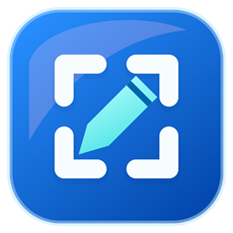

# Snip Studio 0.6.0

A Windows screenshot and screen-recording workspace by [Automation Forge](https://automation-forge.com/).

Capture across monitors, annotate images, edit recognized text, and export the result. The editor starts compact and can resize around a snip.

## Editor tool update in 0.6.0

- Choosing annotation tools keeps the normal arrow pointer; editing grips retain useful resize and move cursors.
- **Shapes** offers Rectangle, Ellipse, Line, Arrow and **Emoji**. Fill and Outline have separate color, None and opacity choices; Outline also controls size. Apply accepts the popup draft; Cancel leaves the style unchanged.
- **Text** lets you click and type directly on the snip. Enter adds a line; **Ctrl+Enter / Done** finishes; **Escape / Cancel** discards the draft. **Advanced text…** retains the full formatting editor. Right-click while typing for editing commands.
- Emoji stamps remain editable text. Choose a symbol, then click to place it; use Move or Text to adjust it. Appearance follows Windows fonts.

Version 0.6.0 passed 513 signed-library component checks, 2,442 unshown layout checks, and 73 installer close source-policy checks on November 13, 2026. These checks do not establish live popup focus, physical DPI, screen capture or installed-upgrade acceptance. Existing saved preferences are retained; their schema is unchanged.

## Capture and edit

- Rectangle, freeform, window, and scrolling capture. **Full screen** lets you choose one monitor; **All monitors** captures the connected desktop.
- Ordinary screenshots hide only the initiating editor and Settings, leaving other open snips visible. To include the initiating editor as well, choose **More → Capture open snips**. This is a one-shot action; a Scrolling choice uses Rectangle for that shot while preserving the selected mode and timer.
- Movable pen strokes, highlights, arrows, boxes, and rich text notes, with Undo and Redo. Right-click a mark to select it and switch to Move; use the middle mouse button to pan.
- A pending **Remove area** box also survives switching to **Move**. Drag it within the image or nudge with arrow keys (Shift moves ten pixels), then press **Delete** to apply the removal at its new position. **Escape** cancels. Moving this review box changes no captured pixels, annotations or Undo history; Undo restores pixels after deletion.
- Drag an arrow's tip or tail to rotate or resize it. Drag a text note's side handles to change wrapping width without shrinking its font.
- Choose **Crop** to start with a full-image frame. Drag its eight edge/corner handles or move the frame by dragging inside. **Apply crop / Enter** commits one Undo step; **Cancel / Escape** keeps the image unchanged. Applying the unchanged full-image frame is a no-op, and entering Crop preserves zoom and image center. Retained annotations stay editable.
- Double-click a text note, or select it and press F2, to edit font families, point sizes, mixed character styles, ink/highlighting, paragraph alignment, lists, indentation, and spacing.
- Local, on-demand Windows OCR for copying words, snapped highlighting, and line editing. Deleting selected bitmap words masks those words and leaves gaps; it does not reposition the remaining screenshot text.
- Color swatches, recent colors, hex input, and an Exact color honeycomb picker. Tooltips are on by default and can be turned off in Settings.
- PNG, JPEG, BMP, lossless image-backed PDF, clipboard copy, print, external-editor working copies, and Windows Share. Save As is available from the menu and Ctrl+Shift+S.

Source-font matching is an **estimate** from screenshot pixels and installed fonts. Line replacement uses a selectable solid fill; complex backgrounds are not reconstructed. Ambiguous overlapping text is guarded. Exports flatten annotations; notes remain editable in the open editor. PDFs are not searchable text documents or editable forms, and transparency becomes white.

Updating to **0.5.9 retains your existing saved app settings**. The crop feature adds no preference fields or reset; it reuses the existing profile.

Ctrl+wheel zooms toward the pointer by default; the wheel alone scrolls. Settings can switch to plain-wheel zoom, remember or reset capture delay, and preview screenshot-border color and thickness inline.

The 0.5.5 wheel animation keeps its drawing position separate from native scrollbar updates until the motion finishes or is interrupted. This addresses jitter during rapid wheel input and direction changes while retaining pointer anchoring. Component checks passed; physical wheel feel and painting still need live acceptance.

The More menu anchors to its button and clamps its position to that monitor's working area. Oversized menus use native scrolling. Left/right toolbars contribute their complete measured height to the editor minimum, bounded by the working area; shorter displays keep a scrolling fallback. Physical monitor/DPI placement and pointer dragging still need live acceptance.

## Taskbar shortcuts and recent images

Open Snip Studio once, then right-click its Windows taskbar icon. **Tasks** offers an immediate screenshot or one in **3, 5, or 10 seconds**, including when the editor is closed. Each task applies its delay to that one snip; it does not change the saved timer or **Remember capture delay**. Taskbar capture uses Photo mode, and a previous Scrolling choice returns to Rectangle so the countdown is honored.

**Recent** contains successfully opened or saved PNG, JPG, JPEG, BMP, GIF, TIF, and TIFF images, including automatically saved originals. Choose an entry to reopen the image in Snip Studio. Unsaved clipboard images, canceled or failed saves, PDF exports, and recordings are not added to this image list. Windows owns the history, removed entries and recent-item privacy setting; the app does not keep a separate recent-file database or change the default image application. Windows also supplies **Pin/Unpin** and **Close window** according to the taskbar icon's state.

Native Jump List appearance, existing-pin refresh and Windows recent-item behavior require live acceptance; component checks alone do not establish those outcomes.

If the menu is missing or stale, choose **More → Refresh taskbar menu**, or use the same action in either notification-area menu mode. Startup also refreshes registration and repairs the identity on Start menu, desktop and pinned shortcuts whose target is this exact application copy. Refresh runs in the background, combines concurrent requests and reports the completed attempt or warnings. It does not force pinning/unpinning or choose a default image application. Windows controls its taskbar cache; a completed registration attempt is not proof of an immediate redraw.

## Update notifications

**Check for updates automatically** is **On by default**. The app checks the official GitHub releases in the background when it opens, at most once a day. Turn it off under **Settings → Updates**. **More → Check for updates** and the notification-area menus offer a manual check; short cooldowns and server rate limits still apply.

After a transient connection failure, manual checking can retry after ten seconds. Cancellation, timeout and connection outcomes are reported separately with safe reason messages. Historical 0.5.8 product-host HTTPS evidence is recorded below; the exact cause of the earlier 0.5.7 connection error remains unconfirmed, and other networks/proxies still need acceptance. Certificate validation is not bypassed.

When a newer version is available, choose **Download** or **Download update** to open its official installer URL in your browser. Snip Studio does not silently download, install or run an update. Requests include the app version, not captures, recognized text, preferences or user identity. A failed check reports an unavailable state rather than claiming that the app is up to date.

## Scrolling capture

Choose **Photo mode → Scrolling**, then select the moving content rather than fixed sidebars or message boxes. Capture advances only while a usable overlap can be verified. Localized animation can be tolerated; broad animation, repeated content, or reflow can stop the capture.

**Finish** opens a preview; **Cancel** discards the capture. Review the joins and bottom before choosing **Use capture**. An early stop or repeated lack of movement produces a partial, **bottom-unconfirmed** result, not proof that the entire page was captured. The previous snip stays intact until the preview is accepted.

Limits are three minutes, 300 scroll requests, 100 accepted frames, 30,000 pixels high, and 64 million pixels. Real applications and physical monitor/DPI behavior still need live acceptance.

## Offline translation

The complete signed release supplies the Bergamot WebAssembly engine, Node runtime, six compact translation models, license notices, and corresponding-source archives. Keep the entire `translation` folder beside `Snip Studio.exe`; extract portable packages completely.

Included languages are **English, German, Spanish, and French**. Models translate English in both directions with each other language; other supported pairs use English as an intermediate step. Choose the source and target explicitly. No Python, Docker, server setup, paid API, subscription, API key, or translation-time model download is needed for the included package.

In Text actions, select words or use all recognized text, then choose **Translate**. Copy the result or use **Replace text in snip** to place replacements in the recognized line bounds. Review wording, font estimates, and solid background fills; one Undo restores the original replacement operation. Compact models and intermediate translation can reduce accuracy. The included workflow does not upload text or images to a translation service.

The public checkout includes the application bridge, patched licensed JavaScript, license text, manifests, and preparation scripts. **It is not a complete, automatically reproducible translation bundle.** Model weights, runtime binaries, bulk downloads, and corresponding-source archives are supplied in release packages rather than this checkout. Preparation scripts require additional metadata and source/download inputs; copying only these sources does not produce a working offline translator.

Upstream projects: [Bergamot](https://github.com/browsermt/bergamot-translator), [Node.js](https://github.com/nodejs/node). Their component notices and licenses remain separate from the application's licensing status.

## Record and make smaller copies

Choose microphone and system-audio devices separately. Recording currently produces H.264/AAC MP4 up to **1920 × 1080 at 15 fps**, with larger areas scaled proportionally.

Recording review offers play, copy, save, trim, and **Make smaller**. Choose 720p, 480p, or a target file size to save a separate copy while preserving the original. Targets are estimates; actual output size is reported, and email/chat attachment limits vary. Smaller exports trade image detail for file size.

Taskbar hiding applies to screenshots and video. Hide taskbars and Keep main monitor taskbar visible default On for new or previously unconfigured profiles; Settings can change either choice. Hidden taskbars are restored after the snapshot or recording ends. Live multi-monitor timing is not established by source or component checks.

## Install, close, and build

Requires Windows 10 or 11 and .NET Framework 4.8. Use a complete signed per-user release installer or extract a portable ZIP. Setup does not launch the app. Its optional sign-in component is unchecked by default. Save work and choose **Exit Snip Studio** before an upgrade; the installer does not force-close running copies.

The installer asks permission before requesting that an in-use copy close. **No** is the default. Only **Yes** allows a normal close request; unsaved-work, recording, or text-draft prompts may still need attention, and canceling closure blocks the update. Silent installs and read-only **CHECKREADY/CHECKBROKER** diagnostics never request closure. Older copies may require a manual **Exit Snip Studio**. The installer stays blocked while files remain in use and never force-closes an application.

Closing an editor closes that snip. **Keep capture shortcuts after closing** is on by default, leaving a small notification-area listener for Ctrl+Alt+S and Print Screen. Choose **Exit** from its menu to stop the listener, or disable that preference to exit with the last editor. Keeping the full editor hidden in the notification area is a separate opt-in. Windows can reserve Print Screen; Snip Studio does not silently change Windows' routing.

Build the application in PowerShell on Windows:

```powershell
.\build.ps1 -UseExistingIcons
```

The C# 5 build uses the installed Windows Framework compiler and WinRT metadata, without NuGet packages. Output defaults to `dist`; a local build is unsigned. The build compiles the app without launching it or running development checks. Optional development checks require separate invocation. Omitting `-UseExistingIcons` compiles and runs the checked-in icon generator.

Selected `checks/Verify-*.ps1` sources cover crop frames, taskbar request/task definitions, menu placement, side-toolbar height, removal-selection movement and scrolling with synthetic inputs. Run them separately in Windows PowerShell 5 against a matching, verified signed release, for example:

```powershell
powershell.exe -STA -NoProfile -File .\checks\Verify-CropFrame.ps1 -ReleaseFolder release-0.5.9-signed -ExpectedVersion 0.5.9.0
```

The scripts validate the signed assembly before loading it. Their generated reports and images are excluded from Git; these checks do not replace live UI or device acceptance.

The source also includes a Python installer integrity checker. Run `python checks/Verify-InstallerIntegrity.py path/to/Setup.exe` on the compiled Setup before signing and again after signing. It reads the embedded NSIS checksum without launching Setup; a mismatch fails the check. Release verification also requires a valid timestamped Authenticode signature and matching payload hashes. The installer's own integrity checks remain enabled. Python is needed only for this development check, not to run Snip Studio.

See [installer packaging](installer/README.md) for the signed-release inputs. Private signing credentials and the publisher's signing workflow are excluded.

## Files and verification

Original screenshots can save automatically to the chosen folder; Save keeps annotation edits. Editing, OCR, recording, PDF export, compression, and bundled translation run locally. Automatic update checks contact the official GitHub release endpoint by default and can be disabled in Settings; capture content, recognized text, preferences and user identity are not sent. Browser downloads, sharing, external-editor opening and website visits require a selected action. Uninstall preserves captures, recordings, preferences, working copies, and unlisted files.

The final 0.5.9 application built without compiler warnings and has a valid timestamped Automation Forge LLC signature. Against its exact signed bytes, **593 signed-library checks passed**: 392 core checks (78 crop frame, 88 translation, 181 zoom frame and 45 removal movement) plus 201 offscreen crop-layout checks across eight toolbar/dimension/scale cases at scales 1, 1.5 and 2. **73 installer source-policy checks** passed separately. Two synthetic offscreen renders were visually inspected for full and adjusted frames with eight handles; those inspections do not add to the automated count. `VALIDATION.txt` records the exact application hash and coverage.

The preferences source is byte-identical to 0.5.8 and reuses the existing settings file; the crop feature adds no preference fields or reset. Installer logic is unchanged apart from version metadata. This is source evidence for saved-setting preservation, not an executed upgrade with the user's installed profile.

Physical mouse/keyboard/DPI behavior, capture of open snips, cross-monitor restoration, native taskbar/cache behavior, browser download/notification acceptance, installed upgrades and endpoint-security acceptance still require live checks. Component/offscreen checks and synthetic render inspection do not establish those outcomes; package signatures, payload hashes and readiness evidence are recorded separately. No new own-host update or approved-close trial is claimed for 0.5.9.

Historically, the signed **0.5.8** application passed 689 signed-library checks and 73 installer source-policy checks. Its exact product host also completed a live HTTPS metadata request with .NET Framework 4.8/Windows TLS defaults, UpToDate status, exit 0 and preferences unchanged. This was actual product-host evidence rather than a PowerShell substitute, but does not identify the earlier 0.5.7 failure's exact cause or prove behavior on every network. These historical checks do not add to the current 0.5.9 totals.

Historically, the signed 0.5.7 application passed **418 component checks** and **73 installer source-policy checks**. A user-approved **CHECKCLOSE** diagnostic on a signed candidate with an older payload closed the installed 0.5.6 listener without changing its executable or installing files. This does not identify the earlier reported 0.5.5 tray-close failure's cause or prove the final full upgrade. No native close trial was repeated for 0.5.8.

Historically, the signed 0.5.6 application passed **272 signed-library checks**, plus **35 in-memory native Windows Shell-link/property round trips** and **39 installer source-policy checks**. Those objects were held only in memory: no shortcut was saved and no application entry point, recent-history API, Jump List update or association helper was called. These counts do not add to the current 0.5.7 totals.

Historically, the 0.5.5 application had a valid timestamped Automation Forge LLC signature. Against those exact signed bytes, **590 component checks passed**: 181 wheel-frame/anchor, 34 cooperative-exit protocol/lifetime, 25 view-motion, 10 view-preservation, 207 side-toolbar layout, 45 removal-box movement, and 88 shortcut/lifetime/text-replacement checks. They loaded the application as a library using controlled synthetic inputs, without capturing a desktop, displaying an editor or menu, injecting native input, requesting native shutdown, or changing user preferences or the registry. `VALIDATION.txt` retains those results and the separately recorded installer source-policy checks; source checks do not establish interactive installer behavior.

Historically, 658 focused checks passed against signed **0.5.4**; earlier release results do not verify 0.5.9. Physical wheel smoothness, monitor/DPI placement, pointer dragging, native scrolling, Share, audio/taskbar behavior, approved-close/save-cancel interaction, legacy close behavior, and full installation/upgrade/uninstall still need live acceptance. HDR correction remains experimental.

An independent Automation Forge app; not affiliated with Microsoft. No open-source license has been added to this repository.
